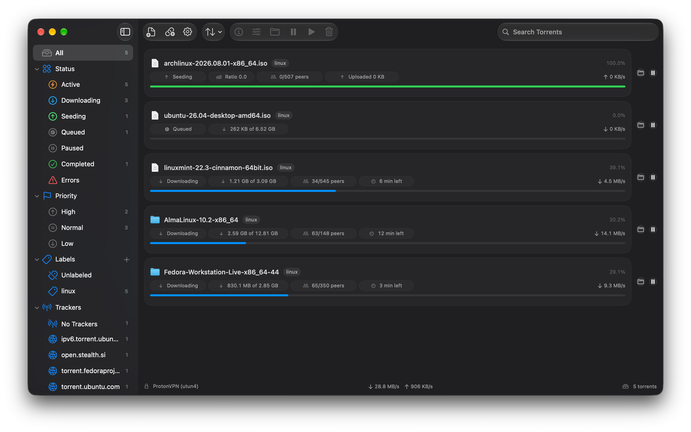

<p align="center">
  
</p>

<h1 align="center">Torrent 7</h1>

<p align="center">
  A modern and hardened torrent client for macOS.
</p>

<p align="center">
  <strong>Requires macOS 27 on Apple silicon.</strong>
</p>

<p align="center">
  
</p>

## Table of Contents

- [Purpose](#purpose)
- [Architecture](#architecture)
- [Features](#features)
- [Security and Hardening](#security-and-hardening)
- [Dependencies](#dependencies)
- [Build](#build)
- [Diagnostics and Tests](#diagnostics-and-tests)
- [Contributing](#contributing)

## Purpose

Torrent 7 is a macOS torrent client built around a security goal: use every
applicable mitigation offered by modern macOS and Apple silicon to contain
untrusted workloads and limit exploitation. A torrent client continuously
handles untrusted metadata, tracker responses, and peer traffic. The project
aims to make vulnerabilities harder to exploit and constrain what a compromised
component can access or affect.

That goal drives the architecture and implementation. Memory-safe Swift, bounded
parsing, and strict compiler checks reduce opportunities for memory corruption.
Separately sandboxed GUI and engine processes, authenticated IPC, and exact-file
access keep authority narrow. Apple's Enhanced Security protections, arm64e
pointer authentication, hardened heap, checked allocations on supported hardware,
and native compiler hardening provide further layers of mitigation around
libtorrent and the remaining native code.

Following current macOS, Apple silicon, and toolchain capabilities is deliberate:
older-platform compatibility must not constrain the security design. These
protections belong in a practical client with a compact, native SwiftUI interface,
where adding torrents, choosing files, and inspecting transfers remain fast and
straightforward.

## Architecture

Torrent 7 has two separately sandboxed executables. The pure-Swift GUI owns
SwiftUI state, user consent, persistent security-scoped bookmarks, storage
claims, destination creation, and payload deletion. It talks over a versioned,
bounded XPC protocol to a system-managed engine extension, which owns network
access, resume state, remaining native protocol execution, and libtorrent.
Magnet links are consumed by a shared bounded Swift parser and cross XPC as a
validated typed model rather than raw text. Payload I/O is
pathless across this boundary: the helper asks a mutually authenticated GUI
broker for one exact file descriptor at a time. Inside the helper, a narrow C
ABI remains the language boundary around the C++23 bridge; it is no longer part
of the GUI process.

See [architecture and security decisions](Documentation/Architecture.md) for
ownership, lifecycle, and security invariants, and the
[documentation index](Documentation/README.md) for all guides.

## Features

- Add `.torrent` files, magnet links, Finder-opened torrents, and dragged files.
- Preview torrent contents before adding, including selected files and priorities.
- Browse nested files in a collapsible tree and set priorities for entire folders.
- Sort files within their folders by name, size, priority, or download progress using the column headers.
- Double-click a file or folder in the torrent inspector to reveal it in Finder.
- Inspect connected peers in a compact sortable table, with offline country flags,
  peer progress, payload rates, and connection details. Country data is provided by
  [DB-IP](https://db-ip.com/); see [peer countries](Documentation/PeerCountries.md).
- Pause, resume, remove, reannounce, force recheck, reveal in Finder, and inspect transfers.
- Configure global and per-torrent transfer limits, queue priority, labels, and discovery policy.
- Inspect trackers, web seeds, files, piece maps, peer sources, hashes, and transfer metadata.
- Filter the library by status, priority, labels, and tracker host.
- Show native notifications, Dock badges, and optional Dock transfer-rate labels.
- Persist resume data and active download-folder access across launches.

## Security and Hardening

- **Separate authority:** both executables use App Sandbox. The GUI creates
  payload files and retains folder access; the helper receives exact file
  descriptors and owns torrent networking. The GUI has no network entitlement.
- **Bounded input:** authenticated XPC and typed Swift parsers constrain
  untrusted data before it reaches the native engine. See the
  [protocol parsing contracts](Documentation/MetainfoParsing.md) and
  [remaining native parser inventory](Documentation/NativeParserInventory.md).
- **Data preservation:** durable storage claims track ownership and access.
  Uncertain operations retain the authority needed for safe teardown and
  recovery. Imported data is never automatically deleted.
- **Platform hardening:** arm64e pointer authentication, Enhanced Security,
  checked allocations on supported hardware, strict Swift checks, and native
  compiler hardening are part of the [build baseline](Documentation/Toolchain.md).
  Both executable bundles enable file quarantine.
- **Constrained dependencies:** libtorrent and BoringSSL are linked statically.
  HTTPS uses macOS system trust with strict hostname binding. The reviewed
  [patch series](Scripts/patches/README.md) enforces application-specific
  storage, network, allocation, and authentication contracts.

Anonymous mode and DHT privacy lookups are enabled by default. Incoming
connections, peer exchange, and local discovery are disabled by default.
Torrent 7 can restrict transfers to a selected network interface or VPN
interface, but hostname lookup uses macOS system DNS. This is app-level policy,
not a system-wide VPN kill switch. See [network authority](Documentation/Architecture.md#network-authority).

For vulnerability reporting, see the [security policy](SECURITY.md).
For startup, folder-access, or saved-state problems, see
[troubleshooting and recovery](Documentation/Troubleshooting.md).

## Dependencies

| Dependency | Use | Authoritative pins |
| --- | --- | --- |
| libtorrent-rasterbar | Torrent engine | [Build configuration](Scripts/build-deps.zsh) and [patch manifest](Scripts/libtorrent-patch-series.sh). |
| BoringSSL | TLS support for libtorrent | [Build configuration](Scripts/build-deps.zsh) and [patch manifest](Scripts/boringssl-patch-series.sh). |
| Boost | Header-only components used by libtorrent | [Build configuration](Scripts/build-deps.zsh) and [patch manifest](Scripts/boost-patch-series.sh). |

Homebrew supplies build tools only. The app contains no third-party dylibs;
its two Mach-O executables are the GUI and engine extension. Bundled
[third-party notices](Packaging/ThirdPartyNotices.txt) must match the reviewed
source exactly. See the [dependency upgrade procedure](Scripts/patches/README.md#updating-a-dependency)
for pins, patch review, provenance, and verification.

## Build

Use macOS 27 on Apple silicon and the Xcode version pinned in the
[toolchain baseline](Documentation/Toolchain.md). From the repository root:

```sh
brew install cmake ninja
Scripts/verify-xcode.zsh
Scripts/build-app.zsh
```

The default build produces an optimized, ad-hoc-signed app at
`.build/App/Torrent 7.app` and verifies its bundle and hardening. It needs no
Apple Developer credentials. Ad-hoc builds use reduced-assurance development
XPC authentication; identified builds use mutual same-team requirements.

See the [development guide](Documentation/Development.md) for debug and sanitizer
builds, incremental work, CI reproduction, and safe cache cleanup. See
[release preparation](Documentation/ReleaseDiagnostics.md#preparing-a-release)
for versioning, Developer ID signing, notarization, and retained evidence.

## Diagnostics and Tests

The [contributor verification requirements](CONTRIBUTING.md#required-verification)
define which checks each change needs. With native dependencies built:

```sh
Scripts/test-swift.zsh
Scripts/analyze-bridge.zsh
Scripts/test-bridge.zsh
```

The [development guide](Documentation/Development.md#tests-and-diagnostics)
links the dependency security suites, sanitizers, fuzzing, and benchmarks.
[Release and UI diagnostics](Documentation/ReleaseDiagnostics.md) covers
packaging, repeated lifecycle tests, accessibility, and Instruments.

## Contributing

Read [CONTRIBUTING.md](CONTRIBUTING.md) for shared design policy, the task reading
map, required verification, and documentation responsibilities. The
[coding standards](Documentation/CodingStandards.md) apply to all contributors.
[AGENTS.md](AGENTS.md) adds agent-specific workflow and mandatory reading.
